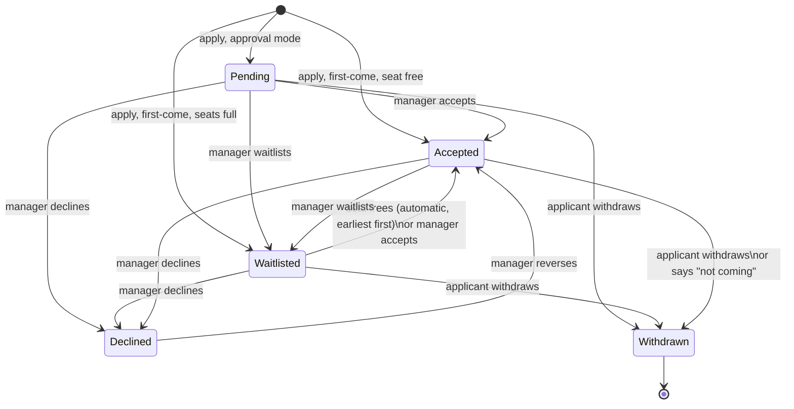

# Application lifecycle

Serves UC-12, UC-13, UC-14 (R-48 to R-59). `Pending` is new: the approval entry mode
(R-27, UC-12 7b) needs a state that is neither in nor queued.

**Rules on every transition**
- Leaving `Accepted` in a first-come event frees a seat: the earliest `Waitlisted` becomes `Accepted` in the same change, and is notified.
- A manager accepting over the seat cap must confirm; the cap does not change.
- Every manager transition is audited and notifies the applicant (not switchable off).
- Nothing moves while the event is `Complete`.
- Answer edits are allowed in `Pending`, `Waitlisted`, `Accepted` while sign-ups are open; withdrawing is allowed at any time before `Complete`.
- The "still coming?" answer (R-56) has three values and only one of them is an edge: `"I can't make it"` from `Accepted`, drawn above. `"Not sure yet"` (R-199) and `"I'll be there"` leave the state exactly where it is, and nothing is promoted on either — an uncertain seat stays held, and what to do about it is the manager's decision, not an automatic one.
- That answer closes two days before the event starts (R-200, UC-13 7) and an event with no start date has no deadline. The closure governs the *answer* only: `→ Withdrawn` stays available right up to `Complete`, which is the rule above and the reason closing the answer is acceptable at all.
